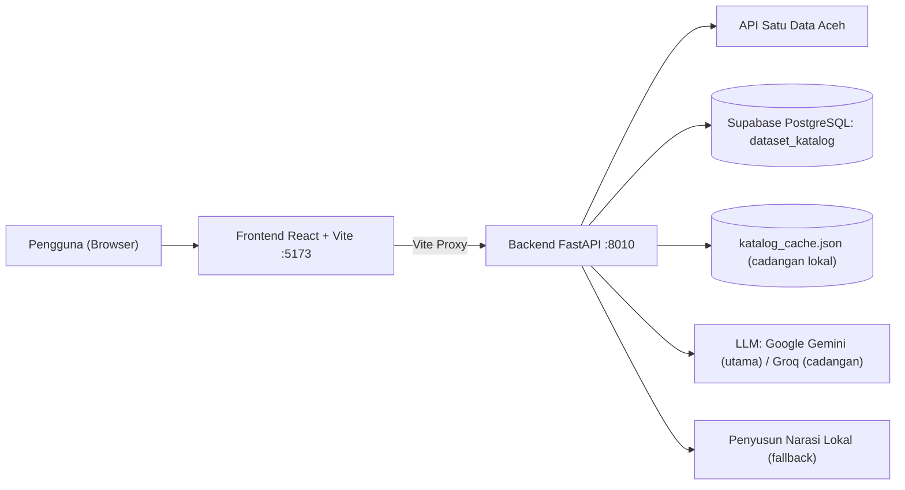
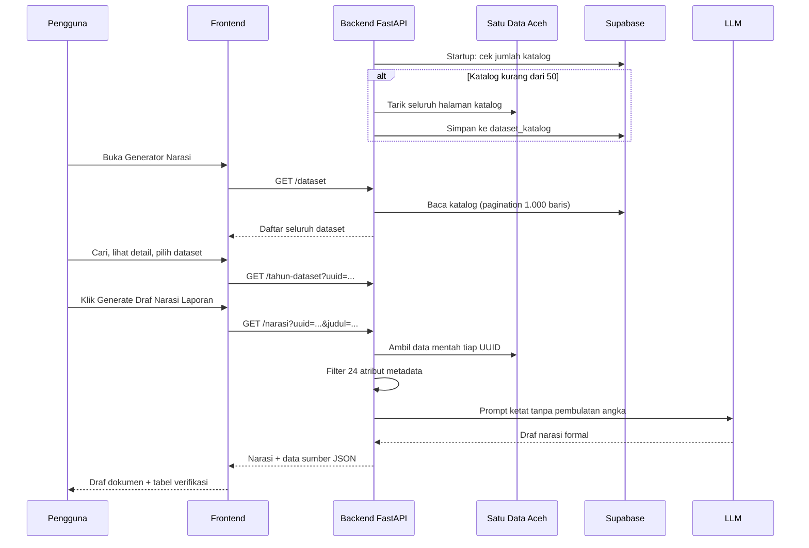

<div align="center">

# NARA-AI

### Sistem Natural Language Generation Berbasis LLM untuk Narasi Laporan Statistik Satu Data Aceh

Platform web yang mengubah dataset resmi **Portal Satu Data Aceh** menjadi draf narasi laporan statistik formal secara otomatis, dengan mekanisme pencegahan halusinasi angka dan tabel verifikasi data sumber.


**Proyek Kuliah Kerja Praktik (KKP)** • UPTD Statistik, Dinas Komunikasi, Informatika dan Persandian (Diskominsa) Aceh

</div>

---

## Daftar Isi

1. [Latar Belakang](#1-latar-belakang)
2. [Fitur Utama](#2-fitur-utama)
3. [Arsitektur Sistem](#3-arsitektur-sistem)
4. [Alur Kerja Sistem](#4-alur-kerja-sistem)
5. [Mekanisme Pencegahan Halusinasi](#5-mekanisme-pencegahan-halusinasi)
6. [Teknologi yang Digunakan](#6-teknologi-yang-digunakan)
7. [Struktur Proyek](#7-struktur-proyek)
8. [Instalasi dan Konfigurasi](#8-instalasi-dan-konfigurasi)
9. [Menjalankan Aplikasi](#9-menjalankan-aplikasi)
10. [Dokumentasi Endpoint API](#10-dokumentasi-endpoint-api)
11. [Panduan Penggunaan Antarmuka](#11-panduan-penggunaan-antarmuka)
12. [Pemecahan Masalah](#12-pemecahan-masalah)
13. [Pengembang](#13-pengembang)

---

## 1. Latar Belakang

Penyusunan laporan statistik daerah menuntut ketelitian tinggi dalam merangkum tabel indikator lintas kabupaten/kota dan lintas tahun menjadi narasi formal. Proses manual memakan waktu dan rawan salah kutip angka.

**NARA-AI** mengotomatiskan proses tersebut: pengguna cukup memilih satu atau beberapa dataset dari katalog Satu Data Aceh, lalu sistem mengambil data mentah, membersihkan atribut metadata, dan menyusun narasi laporan formal menggunakan Large Language Model (LLM). Setiap angka pada narasi dapat dicocokkan langsung dengan tabel data sumber yang ditampilkan berdampingan.

---

## 2. Fitur Utama

| Fitur | Deskripsi |
| :--- | :--- |
| **Katalog Terintegrasi** | Seluruh katalog dataset Satu Data Aceh (ribuan judul) disinkronkan ke tabel `dataset_katalog` di Supabase dan dimuat penuh tanpa batas 5 item. |
| **Auto-Sync saat Startup** | Ketika server backend dinyalakan dan katalog berisi kurang dari 50 dataset, sinkronisasi berjalan otomatis di latar belakang. |
| **Pagination Penuh** | `baca_katalog()` membaca Supabase per 1.000 baris menggunakan `.range(start, end)`, dan `sinkronkan_katalog()` menarik seluruh halaman API Satu Data Aceh. |
| **Pencarian Real-Time** | Pencarian instan pada judul katalog, dipadukan dengan `GET /cari-dataset` (hingga 100 hasil) dan pill filter kategori. |
| **Pratinjau Metadata** | Modal detail dataset menampilkan judul lengkap, UUID, serta daftar tahun yang benar-benar tersedia (`GET /tahun-dataset`). |
| **Filter 24 Atribut Metadata** | Kolom kode wilayah BPS/Kemendagri dan timestamp sistem dipisahkan otomatis sehingga hanya wilayah, tahun, dan nilai indikator yang dikirim ke LLM. |
| **Sintesis Multi-Dataset** | Beberapa dataset dapat digabung dalam satu narasi laporan terpadu. |
| **Gaya Penyajian Laporan** | Pilihan Laporan Formal 2-4 Paragraf, Ringkasan Eksekutif, atau Analisis Perbandingan Wilayah. |
| **Verifikasi Data Sumber** | Tabel data mentah JSON lengkap dengan pencarian baris untuk membuktikan keakuratan setiap angka. |
| **Ekspor Dokumen** | Salin teks, unduh `.txt`, atau unduh `.doc` dengan kop UPTD Statistik Diskominsa Aceh. |
| **Riwayat Sesi** | Narasi yang telah dibuat tersimpan selama sesi browser dan dapat dibuka kembali tanpa generate ulang. |
| **Fallback Bertingkat** | Google Gemini (beberapa model berurutan) sebagai penyedia utama, Groq (opsional) sebagai cadangan kedua, lalu penyusun narasi lokal berbasis aturan, sehingga sistem tetap menghasilkan narasi walau layanan LLM sibuk. |

---

## 3. Arsitektur Sistem

Sistem menggunakan arsitektur **Client-Server** yang terpisah antara antarmuka pengguna (React + Vite + Tailwind CSS) dan layanan REST API (FastAPI + Python).



| Komponen | Peran |
| :--- | :--- |
| **Frontend** | Halaman Beranda, Generator Narasi, modal Tentang Sistem, dan halaman Pengembang. |
| **Backend** | Sinkronisasi katalog, pencarian, ekstraksi indikator, penyusunan prompt, dan pemanggilan LLM. |
| **Supabase** | Penyimpanan katalog dataset (`uuid`, `judul`) dengan Row Level Security aktif. |
| **Cache Lokal** | `backend/katalog_cache.json` dipakai sebagai cadangan jika Supabase tidak dapat diakses. |
| **LLM** | Menyusun narasi formal Bahasa Indonesia berbasis data JSON yang sudah dibersihkan. |

---

## 4. Alur Kerja Sistem



Ringkasan tahapan:

1. **Auto-Sync Katalog**: memastikan tabel `dataset_katalog` terisi lengkap dari API Satu Data Aceh.
2. **Pencarian dan Validasi Tahun**: pengguna memilih dataset, sistem menampilkan tahun data yang benar-benar tersedia.
3. **Pembersihan Metadata**: fungsi `ekstrak_nilai_indikator()` membuang kolom administratif dan menyisakan wilayah, tahun, serta nilai indikator.
4. **Sintesis NLG**: data bersih dikirim ke LLM, lalu narasi ditampilkan berdampingan dengan tabel data mentah.

---

## 5. Mekanisme Pencegahan Halusinasi

| Lapisan | Penerapan |
| :--- | :--- |
| **Grounding Data** | LLM hanya menerima data JSON hasil `GET` ke Satu Data Aceh, bukan pengetahuan umum model. |
| **Pembersihan Input** | 24 atribut metadata (kode wilayah, timestamp, dan sejenisnya) dibuang agar model tidak salah membaca kode sebagai indikator. |
| **Prompt Ketat** | Instruksi wajib: angka harus persis sesuai data, tidak dibulatkan, tidak diubah, tidak ditebak, serta wajib menyebut wilayah dan tahun. |
| **Guard Dataset Kosong** | Jika seluruh dataset terpilih tidak memiliki baris data, pemanggilan LLM diblokir dan `GET /narasi` mengembalikan pesan resmi `"Data tidak tersedia untuk dataset yang dipilih."` sehingga model tidak pernah mengarang narasi tanpa data. Dataset kosong dalam pilihan gabungan juga dilewati dan dilaporkan pada kolom `pesan`. |
| **Temperatur Rendah** | Gemini dipanggil dengan `temperature=0.2` dan Groq dengan `temperature=0.3` untuk menekan variasi kreatif dan menjaga konsistensi angka. |
| **Audit Manual** | Tab **Verifikasi Data Sumber** menampilkan seluruh baris data mentah sehingga setiap angka dapat dicek ulang. |
| **Fallback Deterministik** | Jika seluruh LLM gagal, `_susun_narasi_lokal()` menyusun narasi berbasis aturan langsung dari data tanpa model generatif. |

---

## 6. Teknologi yang Digunakan

| Lapisan | Teknologi |
| :--- | :--- |
| **Backend** | Python 3.10+, FastAPI, Uvicorn, Requests, python-dotenv |
| **Database** | Supabase (PostgreSQL + Row Level Security) |
| **LLM** | Google Gemini (`google-genai`), default `gemini-2.5-flash` dengan model cadangan; Groq (`llama-3.1-8b-instant`) opsional |
| **Frontend** | React 18, Vite 5, Tailwind CSS 3, PostCSS, Autoprefixer |
| **Sumber Data** | API Portal Satu Data Aceh (`https://satudata.acehprov.go.id`) |
| **Versi Kode** | Git dan GitHub |

---

## 7. Struktur Proyek

```text
AI-Narasi-Laporan-KKP/
├── backend/
│   ├── src/
│   │   └── main.py              # Server FastAPI (port 8010): katalog, ekstraksi, prompt, LLM
│   ├── supabase/
│   │   └── schema.sql           # Skema tabel dataset_katalog
│   ├── katalog_cache.json       # Cache katalog lokal (dibuat otomatis)
│   ├── .env.example             # Template environment variable
│   └── requirements.txt         # Dependensi Python
├── frontend/
│   ├── public/
│   │   └── foto-dea.jpeg        # Foto halaman Pengembang
│   ├── src/
│   │   ├── App.jsx              # Navbar, Beranda, modal Tentang Sistem, Pengembang, Footer
│   │   ├── NarasiLaporan.jsx    # Generator Narasi: katalog, konfigurasi, hasil, verifikasi
│   │   ├── index.css            # Tailwind CSS dan animasi antarmuka
│   │   └── main.jsx             # Entry point React
│   ├── index.html
│   ├── package.json
│   ├── postcss.config.js
│   ├── tailwind.config.js
│   └── vite.config.js           # Proxy /dataset, /narasi, /cari-dataset, /tahun-dataset ke :8010
├── .gitignore                   # Mengabaikan .env, node_modules/, venv/, dist/, __pycache__/
└── README.md
```

---

## 8. Instalasi dan Konfigurasi

### 8.1 Prasyarat

- Python **3.10** atau lebih baru
- Node.js **18** atau lebih baru beserta npm
- Akun **Supabase** (gratis)
- API key **Satu Data Aceh** dan **Google Gemini** (Google AI Studio)
- API key **Groq** (opsional)

### 8.2 Clone Repository

```powershell
git clone https://github.com/deazasqiamalau/AI-Narasi-Laporan-KKP.git
cd AI-Narasi-Laporan-KKP
```

### 8.3 Skema Database Supabase

Jalankan skrip berikut pada **SQL Editor** di dashboard Supabase (tersedia juga di `backend/supabase/schema.sql`):

```sql
create table if not exists public.dataset_katalog (
  uuid text primary key,
  judul text not null,
  diperbarui_pada timestamptz not null default now()
);

alter table public.dataset_katalog enable row level security;

-- Backend memakai SUPABASE_SECRET_KEY sehingga dapat melewati RLS.
-- Tidak ada kebijakan anon karena browser selalu mengakses backend, bukan tabel Supabase secara langsung.
```

### 8.4 Konfigurasi `.env`

```powershell
cd backend
Copy-Item .env.example .env
```

Isi variabel berikut di `backend/.env`:

```env
SATUDATA_API_KEY=isi_dengan_api_key_satu_data_aceh
GEMINI_API_KEY=isi_dengan_api_key_gemini
SUPABASE_URL=https://project-ref.supabase.co
SUPABASE_SECRET_KEY=isi_dengan_secret_key_supabase

# Opsional
# GEMINI_MODEL=gemini-2.5-flash
# GROQ_API_KEYS=isi_dengan_api_key_groq
# GROQ_MODEL=llama-3.1-8b-instant
```

| Variabel | Wajib | Keterangan |
| :--- | :---: | :--- |
| `SATUDATA_API_KEY` | Ya | Akses API katalog dan data Satu Data Aceh. |
| `GEMINI_API_KEY` | Ya | Akses Google Gemini untuk penyusunan narasi. |
| `SUPABASE_URL` | Ya | URL proyek Supabase. |
| `SUPABASE_SECRET_KEY` | Ya | Secret key Supabase (format `sb_secret_...` atau JWT `service_role`). |
| `GEMINI_MODEL` | Tidak | Model Gemini utama (default `gemini-2.5-flash`). |
| `GROQ_API_KEYS` | Tidak | API key Groq sebagai penyedia LLM tambahan. |
| `GROQ_MODEL` | Tidak | Model Groq (default `llama-3.1-8b-instant`). |

> [!IMPORTANT]
> File `.env` sudah tercantum di `.gitignore`. Jangan pernah meng-commit kunci rahasia ke repository.

---

## 9. Menjalankan Aplikasi

### 9.1 Backend FastAPI (Port `8010`)

```powershell
cd backend
python -m venv venv
.\venv\Scripts\Activate.ps1
pip install -r requirements.txt
python src/main.py
```

- API aktif di `http://localhost:8010`
- Dokumentasi interaktif Swagger UI: `http://localhost:8010/docs`
- Saat pertama kali dijalankan, katalog akan disinkronkan otomatis di latar belakang.

### 9.2 Frontend React + Vite (Port `5173`)

Buka terminal baru:

```powershell
cd frontend
npm install
npm run dev
```

Akses `http://localhost:5173`. Seluruh panggilan ke `/dataset`, `/dataset/sinkronkan`, `/cari-dataset`, `/tahun-dataset`, dan `/narasi` diteruskan otomatis oleh Vite Proxy ke `http://localhost:8010`.

### 9.3 Build Produksi

```powershell
cd frontend
npm run build
npm run preview
```

Hasil build tersimpan di `frontend/dist/`. Untuk backend di domain berbeda, atur `VITE_NARASI_API_BASE` (misalnya `https://api.domain-anda.go.id`) sebelum build.

---

## 10. Dokumentasi Endpoint API

| Method | Endpoint | Parameter | Deskripsi |
| :--- | :--- | :--- | :--- |
| `GET` | `/dataset` | Tidak ada | Mengambil seluruh katalog (`uuid`, `judul`) dari Supabase dengan pagination. Jika katalog kurang dari 50, otomatis sinkronisasi dari Satu Data Aceh. |
| `POST` | `/dataset/sinkronkan` | Tidak ada | Menarik seluruh halaman katalog dari Satu Data Aceh, menyimpannya ke Supabase, lalu mengembalikan jumlah dan daftar dataset. |
| `GET` | `/cari-dataset` | `kata_kunci` (str), `limit` (int, default `100`) | Mencari dataset berdasarkan kata kunci judul. |
| `GET` | `/tahun-dataset` | `uuid` (str, wajib) | Mengembalikan daftar tahun yang benar-benar tersedia pada dataset. |
| `GET` | `/narasi` | `uuid` (list, wajib), `judul` (list, opsional) | Mengambil data dari satu atau beberapa dataset, mengekstrak indikator, lalu menyusun narasi laporan formal. Setiap dataset diproses hingga **40 baris indikator** pertama agar prompt tetap ringkas dan fokus. |

### Contoh Respons

<details>
<summary><code>GET /dataset</code></summary>

```json
[
  { "uuid": "a1b2c3d4-...", "judul": "Jumlah Penduduk Menurut Kabupaten/Kota di Aceh" },
  { "uuid": "e5f6g7h8-...", "judul": "Persentase Penduduk Miskin Kabupaten/Kota Aceh" }
]
```
</details>

<details>
<summary><code>POST /dataset/sinkronkan</code></summary>

```json
{
  "jumlah": 4051,
  "dataset": [{ "uuid": "a1b2c3d4-...", "judul": "..." }]
}
```
</details>

<details>
<summary><code>GET /tahun-dataset?uuid=...</code></summary>

```json
{ "uuid": "a1b2c3d4-...", "tahun": [2024, 2023, 2022] }
```
</details>

<details>
<summary><code>GET /narasi?uuid=...&judul=...</code></summary>

```json
{
  "judul": "Narasi gabungan: Jumlah Penduduk Menurut Kabupaten/Kota di Aceh",
  "dataset": [{ "uuid": "a1b2c3d4-...", "judul": "Jumlah Penduduk Menurut Kabupaten/Kota di Aceh" }],
  "data": [
    {
      "uuid": "a1b2c3d4-...",
      "judul": "Jumlah Penduduk Menurut Kabupaten/Kota di Aceh",
      "data": [{ "wilayah": "Kota Banda Aceh", "tahun": 2024, "jumlah_penduduk": 265040 }]
    }
  ],
  "narasi": "Berdasarkan data resmi Satu Data Aceh, jumlah penduduk Kota Banda Aceh pada tahun 2024 tercatat sebanyak 265.040 jiwa...",
  "pesan": null
}
```
</details>

---

## 11. Panduan Penggunaan Antarmuka

### Navigasi Utama

| Menu | Fungsi |
| :--- | :--- |
| **Beranda** | Hero section, pratinjau dokumen interaktif (Penduduk, Pendidikan, Kemiskinan), 4 kartu fitur, dan strip metrik sistem. |
| **Generator Narasi** | Ruang kerja utama untuk menyusun laporan. |
| **Tentang Sistem** | Modal penjelasan 4 tahap arsitektur dan alur kerja. |
| **Pengembang** | Profil pengembang, kredensial akademik, kontribusi teknis, stack teknologi, dan tautan media sosial. |

### Langkah Menyusun Laporan

1. **Pilih Dataset Statistik**: cari judul atau gunakan filter kategori (Semua, Penduduk, Pendidikan, Kesehatan, Ekonomi, Kemiskinan). Klik **Detail** untuk melihat tahun data, lalu **+ Tambahkan**.
2. **Konfigurasi Laporan**: tinjau dataset terpilih (hapus dengan tombol `×`), pilih gaya penyajian, lalu klik **Generate Draf Narasi Laporan**.
3. **Hasil dan Verifikasi**:
   - **Draf Narasi Laporan**: atur ukuran teks, salin, atau unduh TXT/DOC.
   - **Verifikasi Data Sumber**: cocokkan setiap angka dengan tabel data mentah.
   - **Riwayat Sesi**: buka kembali laporan sebelumnya.

---

## 12. Pemecahan Masalah

| Gejala | Penyebab dan Solusi |
| :--- | :--- |
| Katalog kosong atau hanya sedikit | Tunggu auto-sync selesai setelah backend menyala, atau klik tombol refresh katalog. Pastikan `SATUDATA_API_KEY` valid. |
| `503: Katalog dataset Supabase belum tersedia` | Tabel `dataset_katalog` belum dibuat atau `SUPABASE_URL`/`SUPABASE_SECRET_KEY` salah. Jalankan `schema.sql`. |
| `Tidak dapat terhubung ke server narasi` | Backend belum berjalan di port `8010`. Jalankan `python src/main.py`. |
| Narasi terasa kaku atau berbasis template | Layanan LLM sedang sibuk atau API key tidak valid, sehingga sistem memakai fallback lokal. Periksa `GEMINI_API_KEY`. |
| `404: Tahun data tidak ditemukan` | Dataset tersebut tidak memiliki kolom `tahun` yang valid di Satu Data Aceh. |
| `Unable to create process` pada venv | Venv dibuat dari Python launcher Microsoft Store. Buat ulang venv dengan Python dari python.org. |

---

## 13. Pengembang

<table>
  <tr>
    <td width="160" align="center">
      
    </td>
    <td>
      <b>Dea Zasqia Pasaribu Malau</b><br/>
      AI & Full-Stack Developer<br/><br/>
      <b>NPM</b>: 2308107010004<br/>
      <b>Program Studi</b>: S1 Informatika, FMIPA Universitas Syiah Kuala<br/>
      <b>Instansi Mitra</b>: UPTD Statistik, Diskominsa Aceh<br/>
      <b>Dosen Pembimbing</b>: Kikye Martiwi Sukiakhy, S.T., M.Kom.<br/>
      <b>Pembimbing Lapangan</b>: Zulham Efendi Irfan, S.H.I, S.H, M.Si
    </td>
  </tr>
</table>

| Platform | Tautan |
| :--- | :--- |
| GitHub Utama | [@deazasqiamalau](https://github.com/deazasqiamalau) |
| GitHub Kedua | [@deazasqiapasaribumalau](https://github.com/deazasqiapasaribumalau) |
| LinkedIn | [linkedin.com/in/deazasqiamalau](https://www.linkedin.com/in/deazasqiamalau/) |
| YouTube | [@deazasqiamalau](https://www.youtube.com/@deazasqiamalau) |
| Instagram | [@deazasqiamalau](https://www.instagram.com/deazasqiamalau/) |
| Repository Proyek | [AI-Narasi-Laporan-KKP](https://github.com/deazasqiamalau/AI-Narasi-Laporan-KKP) |

---

<div align="center">

Dikembangkan untuk Kuliah Kerja Praktik pada **UPTD Statistik • Dinas Komunikasi, Informatika dan Persandian Aceh**

Sumber data: [Portal Satu Data Aceh](https://satudata.acehprov.go.id)

</div>
